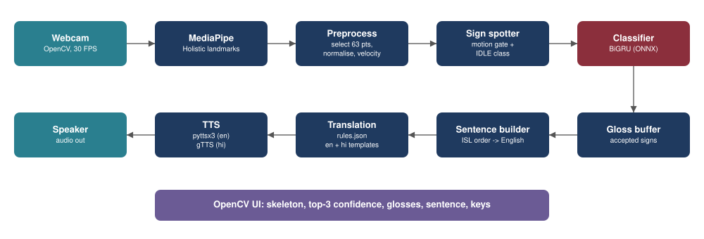
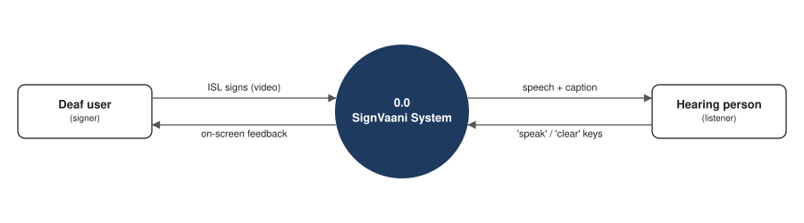
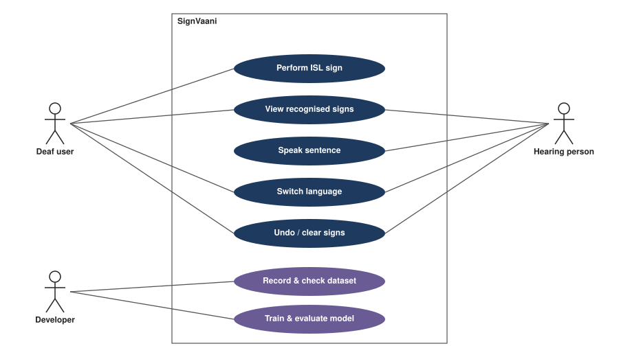
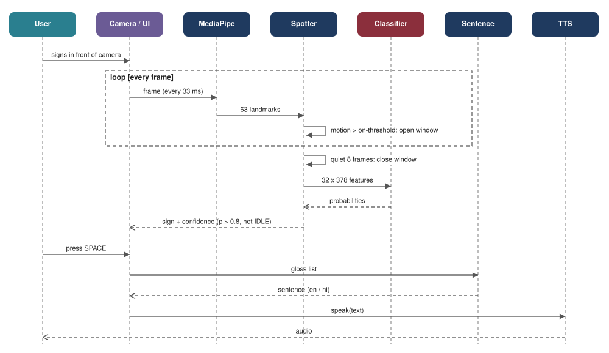

# SignVaani: Software Requirements Specification

Version 1.0, Day 1 of the 1-week blueprint. Owner: D (Docs & QA lead). The scope is frozen: changes
need the whole team's agreement and a line in `docs/daily_log.md`. Values marked [XX] are filled in from
the team's own measurements, never copied from examples.

## 1. Introduction

### 1.1 Purpose

This document states what SignVaani must do and how well it must do it, so that every requirement can
be traced to the module that implements it and the test case that verifies it (blueprint Section 8).
It is the basis of report Chapter 3.

### 1.2 Scope

SignVaani recognises 15 isolated Indian Sign Language (ISL) signs for hospital communication, plus an
`IDLE` (no sign) class, from a normal laptop webcam. It turns the recognised signs into a grammatical
English or Hindi sentence and speaks it. Everything runs on a laptop CPU without a GPU.

| In scope (must be finished) | Out of scope (stated in the report) |
|---|---|
| Isolated recognition of 16 classes from a laptop webcam | Continuous / open-vocabulary ISL translation |
| Automatic sign start/end detection (no button per sign) | Fingerspelling A-Z |
| Rule-based ISL-order to English sentence + Hindi template | Neural translation, LLM sentence polishing |
| Speech: English offline (pyttsx3), Hindi via gTTS | Fully offline Hindi TTS (future scope: Indic-TTS) |
| Signer-independent evaluation (leave-one-signer-out) | Large user study / clinical validation |
| Own dataset: 5 signers x 16 classes x 10 takes = 800 clips | Mobile app |

The frozen vocabulary is in `configs/vocabulary.json`: ME, DOCTOR, PAIN, FEVER, HEAD, STOMACH, WATER,
MEDICINE, TOILET, HELP, NEED, CALL, WHERE, YES, NO and IDLE. The ten demo sentences S1-S10 are in
`configs/sentences.json`.

### 1.3 Definitions

| Term | Meaning |
|---|---|
| ISL | Indian Sign Language |
| ISLRTC | Indian Sign Language Research and Training Centre, whose dictionary is the sign reference |
| Gloss | Written label of one sign, e.g. `PAIN`. ISL order example: `ME STOMACH PAIN` |
| IDLE | Class for "no sign": resting hands and natural movements such as touching the face |
| Landmark | One (x, y, z) body point from MediaPipe Holistic. SignVaani keeps 63 per frame |
| Signer-independent / LOSO | The test signer never appears in training. Leave-one-signer-out trains once per signer and tests on the person left out |
| ONNX | Open model format, run with ONNX Runtime for fast CPU inference |
| TTS | Text-to-speech |
| FPS | Frames processed per second |

### 1.4 References

- `docs/SignVaani_1_Week_Execution_Blueprint.pdf`: scope (Section 2), SRS (Section 4), design (Section 5), tests (Section 8)
- `docs/ISL_Literature_Survey_with_Links.pdf`: related work
- `docs/SignVaani_ISL_Dataset_Guide.pdf`: datasets, recording protocol, privacy
- `docs/recording_protocol.md`: recording protocol and consent form

## 2. Overall description

### 2.1 Product perspective

SignVaani is a standalone desktop application written as a Python package (`signvaani/`). It needs a
webcam and speakers and nothing else.

*Figure 1: System architecture. The top row runs every frame; the bottom row runs once per accepted sign
or sentence. Editable source: `diagrams/architecture.drawio` (open in draw.io / diagrams.net).*

*Figure 2: Context diagram (DFD level 0). Editable source: `diagrams/dfd0.drawio`.*

### 2.2 Product functions

1. Capture webcam frames and extract 63 body, hand and face landmarks per frame.
2. Clean and normalise the landmarks into a fixed 32 x 378 feature window.
3. Detect when a sign starts and ends, and ignore resting and natural non-sign movement.
4. Classify each sign with a confidence score.
5. Build an English or Hindi sentence from the accepted signs and speak it.
6. Record a keypoint dataset with quality checks, then train and evaluate models signer-independently.

### 2.3 Users

| User | Description | Interaction |
|---|---|---|
| Deaf user (signer) | Communicates in ISL, e.g. a patient | Signs in front of the webcam; sees the recognised signs and the sentence; undoes a wrong sign |
| Hearing person (listener) | Does not know ISL, e.g. hospital staff | Hears the sentence and reads the caption; presses SPACE to speak or `c` to clear |
| Developer (project team) | Builds and evaluates the system | Records signers, checks the data, trains, evaluates and exports models |

### 2.4 Operating environment

A laptop with Windows 10/11, Ubuntu 22.04 or macOS 12+, Python 3.10 or 3.11, a front-facing webcam and
speakers. Internet is needed only for Hindi speech, unless that audio was cached beforehand.

### 2.5 Design constraints

- CPU only, no GPU (NFR-1).
- Only landmark coordinates are stored, never video or photos (NFR-3).
- The vocabulary is fixed at the 16 frozen classes until Day 7.
- The whole project must be built, tested and documented in 7 days.

### 2.6 Assumptions and dependencies

- One signer in view, 1-2 m from the camera, upper body and both hands in frame, normal indoor lighting
  from the front.
- Each sign follows the variant recorded in `docs/sign_verification.md` (ISLRTC dictionary, checked by
  an ISL user).
- MediaPipe Holistic 0.10.14 supplies the landmarks. gTTS (Hindi speech) needs internet.
- A native speaker checks every Hindi sentence.

### 2.7 Use cases and the main sequence

*Figure 3: Use-case diagram. The deaf user and the hearing person share the live app; the developer
records, checks, trains and evaluates. Editable source: `diagrams/usecase.drawio`.*

*Figure 4: Sequence of one sign, then speak (blueprint Figure 5). Every frame goes through MediaPipe and
the spotter; the classifier runs once per closed window, and the sentence and speech once per SPACE
press. Editable source: `diagrams/sequence.drawio`.*

## 3. Specific requirements

### 3.1 Functional requirements

| ID | Requirement | Implemented in | Verified by |
|---|---|---|---|
| FR-1 | Capture live video from a webcam at >= 15 FPS. | `app.py` | TC-01 |
| FR-2 | Extract pose, both-hand and face landmarks for every frame. | `landmarks.frame_keypoints` | TC-02 |
| FR-3 | Fill short tracking gaps and normalise landmarks for position and body size. | `landmarks.preprocess` | TC-03, unit tests |
| FR-4 | Detect the start and end of a sign automatically from hand motion. | `spotter.py` | TC-09 |
| FR-5 | Classify each detected sign into one of 16 classes with a confidence score. | `inference.py`, `models.py` | TC-05 |
| FR-6 | Reject the IDLE class and predictions below the confidence threshold (0.8). | `spotter.py` | TC-10, TC-11 |
| FR-7 | Show the skeleton, top-3 predictions, recognised signs and sentence on screen. | `app.py` | TC-13 |
| FR-8 | Convert ISL gloss sequences into grammatical English and Hindi sentences. | `sentence.py`, `rules.json` | TC-07, TC-08 |
| FR-9 | Speak the sentence on demand (SPACE) or automatically after a pause. | `speech.py`, `app.py` | TC-15 |
| FR-10 | Allow undo, clear and language switch from the keyboard. | `app.py` | TC-16 |
| FR-11 | Provide a guided recorder that saves keypoints only and rejects poor-quality takes. | `record.py`, `check_data.py` | TC-04 |
| FR-12 | Train and evaluate models with signer-independent (LOSO) splits. | `train.py`, `evaluate.py` | TC-06 |

### 3.2 Non-functional requirements

| ID | Category | Requirement | Verified by |
|---|---|---|---|
| NFR-1 | Performance | >= 15 FPS and <= 500 ms from sign end to text on an Intel i5 / Ryzen 5 laptop CPU, no GPU. | TC-01, TC-14 |
| NFR-2 | Offline | Recognition and English speech work without internet. | TC-17 |
| NFR-3 | Privacy | No video is saved by the app or recorder; only landmark coordinates (.npy). | TC-18 |
| NFR-4 | Usability | Large text overlay; single-key controls; status indicator (ready / signing). | TC-13, TC-16 |
| NFR-5 | Robustness | Works for signers not in the training set and for normal indoor lighting. | TC-12 |
| NFR-6 | Maintainability | Modular Python package with unit tests; vocabulary and sentence rules in JSON. | `python -m pytest -q` |
| NFR-7 | Portability | Runs on Windows 10/11, Ubuntu 22.04 and macOS with Python 3.10 or 3.11. | `python -m signvaani.check_install` on every machine |

### 3.3 Measurable targets

| Metric | Target | How measured |
|---|---|---|
| Top-1 accuracy, signer-independent (LOSO mean) | >= 80% | `train --loso`, 5 folds |
| Top-1 accuracy, signer-dependent (random split) | >= 95% | `train --random-split` |
| Live sign accuracy on an unseen person | >= 70% of 60 attempts | TC-12 |
| False triggers while idle | <= 1 per minute | TC-10 |
| Processing speed | >= 15 FPS on CPU | FPS shown in the app |
| Sign end to text on screen | <= 500 ms | TC-14 |
| Sentence correctness for S1-S10 | 10 / 10 | TC-07, TC-08 |

### 3.4 External interfaces

- **User interface:** an OpenCV window showing the skeleton, the status (ready / SIGNING), motion value,
  FPS, language, top-3 predictions with confidence, the recognised signs and the sentence. Keys: SPACE
  speak, `c` clear, `u` undo, `l` switch English/Hindi, `s` skeleton on/off, `f` full screen, `q` quit.
- **Hardware:** a webcam (OpenCV camera index) and speakers.
- **Software:** MediaPipe Holistic 0.10.14 (landmarks), ONNX Runtime (CPU inference), PyTorch
  (training), pyttsx3 (offline English speech), gTTS and pygame (Hindi speech and playback).
- **Files:**

| File | Content |
|---|---|
| `configs/vocabulary.json` | Frozen 16-class sign list |
| `configs/sentences.json` | Frozen demo sentences S1-S10 with expected English and Hindi output |
| `signvaani/rules.json` | Lexicon and sentence patterns (English, Hindi) |
| `data/keypoints/<SIGN>/<signer>_<take>.npy` | One recorded take: float32 (T, 63, 3), NaN where a body part was not detected |
| `models/sign_model.onnx` + `.json` | Exported classifier with its labels and window length |

### 3.5 Data requirements

Each frame keeps 63 MediaPipe landmarks: 9 pose, 12 face, 21 left-hand and 21 right-hand points, each as
(x, y, z). A body part that was not detected is stored as NaN, never as zeros. Gaps of up to 6 frames are
interpolated. Each sign window is resampled to 32 frames, centred on the shoulders, divided by shoulder
width, and extended with frame-to-frame velocity. That gives a 32 x 378 model input. Signers are stored
as anonymous IDs (s01, s02, ...), never names.

### 3.6 Hardware and software requirements

| Item | Minimum | Used by us (fill in) |
|---|---|---|
| CPU | Intel i5 8th gen / Ryzen 5 | [XX] |
| RAM | 8 GB | [XX] |
| Camera | 720p webcam, front-facing | [XX] |
| OS | Windows 10/11, Ubuntu 22.04, macOS 12+ | [XX] |
| Python | 3.10 or 3.11 (MediaPipe 0.10.14 wheels) | [XX] |
| Libraries | mediapipe, opencv-python, numpy, torch (CPU), onnxruntime, scikit-learn, matplotlib, pyttsx3, gTTS, pygame | - |
| Training | Laptop CPU is enough for 800 clips (blueprint estimate: about 2-5 min per model); Google Colab optional | [XX] |

## 4. Feasibility

- **Technical:** every component is open source and runs on a laptop CPU. MediaPipe gives landmarks in
  real time, and the main model is small (about 0.5 M parameters, blueprint Section 5.4).
- **Economic:** no paid software or special hardware is needed beyond the team's laptops and webcams.
- **Operational:** single-key controls, and English works offline. The tool supports human interpreters
  and does not replace them in medical, legal or emergency settings.
